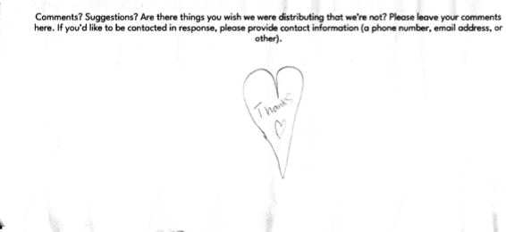

It has always been important to us to collect feedback and suggestions from LFFC. We've been fortunate enough to have excellent advice on what to provide and what to try from a variety of people close to the project, but that doesn't mean we've thought of everything, nor that we can't improve. We accept comments and suggestions through a [Google Form](/suggestions) and via email, but not everyone has access to those in a consistent way; hence we also have paper comment sheets, and a small birdhouse to collect them. (The birdhouse worked so well for the Futel phone that we continued the theme.)

We read every comment, and we think about every suggestion. If you look below, you'll find, among many others, the comments that caused us to start giving away warm hats and gloves, hand sanitizer, and ibuprofen, as well as the ones that made us iterate on our charging strategy several times, and the one requesting WiFi that eventually became the [Connections](/connections) project. We absolutely appreciate and value the feedback we get from the people most in need of assistance, even when it's impossible for us to do. (For instance, we've had many requests for drugs which, while they're not abusable, require prescriptions in the US (e.g., [albuterol](https://en.wikipedia.org/wiki/Salbutamol)); while [Washington's naloxone standing order](https://doh.wa.gov/sites/default/files/legacy/Documents/Pubs/150-127-StatewideStandingOrderToDispenseNaloxone.pdf) allows us to distribute that prescription drug, we're not aware of similar regimes for anything else.)

Paper comments seem to come in bursts; we'll have none for weeks, and then three in a single day, from three separate authors. We've read them all, then scanned them for archival purposes. We've always meant to make them all public (aligning with our general open source / transparency idea), so now we are.

This post collects all the comments since we began in September 2024 (with a few exceptions for ones we've lost, sorry about that). We scan comments periodically, so they're in batches (the dates are when we scanned them). We intend to post everything we receive; outcomes may vary based on whim. We will of course remove any contact information or names, because (while we've no actual enforceable obligation to do that) not doing it seems extraordinarily invasive and rude.

To avoid this page being catastrophically humongous (since we don't use JavaScript), we're only going to include a few images directly on this page, and link to the rest. 

(Screenreader users: if we link to an image on this page, the link text is the transcription. If we include the image on this page, it will have both a visible caption and alt text, both containing the transcription. All transcriptions are done by the same 1980s-era computer that counts the condoms.)

* October 2026
  * ["Thank you for doing this! I live in the neighborhood. Please let me know if you need any donations or help."](2026-10/0000-edited.png)
  * !["Saying goodbye - Thank you so much for all you do. I have to thank you for making my life much more comfortable thru all the shit I put myself thru. You have probably (unclear) thousands + not (unclear) known it. We kill ourselves with dope + some actually technically do. But today I'm using this or another nearby free phone to go home... or to the home of my brother or other family member. I can't be out here on dope anymore. I'm going to try to get my life back. Just wanted to thank you guys. God bless you."](2026-10/0001-edited.png)
* September 2026
  * ["Thank you so much. I wish you knew just how helpful you are & the influence you have on those who feel most hopeless. Thanks again"](2026-09/0000-edited.png)
  * ["Don't touch yourself at night. do it in the morning please and use K&Y jelly watermelon or unscent. grassy ass"](2026-09/0001.png)
  * ["nothing"](2026-09/0002.png)
  * ["If there's a chance I'm (redacted) I need a phone I will check tomorrow if I can to see any options mine was stolen Thank you"](2026-09/0003-edited.png)
  * ["Love you guys. Thanks for everything - also I would love to see more (unclear)"](2026-09/0004.png)
  * ["I don't have a phone but please some food, H2O & hydration packets, neosporin, jobs available long term, short term... " (unclear)](2026-09/0005-edited.png)
  * ["I appreciate the charging station for a convenient place to charge and go. Thank community."](2026-09/0006.png)
  * ["Thank you for being help and to be help."](2026-09/0007.png)
  * ["Just wanna say god bless. Thank you"](2026-09/0008-edited.png)
  * ["God bless to all and to all have a great day..." (unclear)](2026-09/0009.png)
* July 2026
  * ["This is an example of true community bldg. Can we help to keep it stocked?"](2026-07/0003-edited.png)
  * ["Neighbor by Othello Park. Sorry some people can't respect free resources in the neighborhood. To be honest I only grabbed 3-4 pads because I've been relying on this resource box since 2023. Maybe a fence & a lock around it? Like how they do on the East Coast."](2026-07/0006.png)
  * ["What happened to the chargers?? They were really useful. Pls. Bring Back."](2026-07/0012.png)
  * ["Thank you for listening to me. I'm happy I'm being heard. Godbless. Neosporin, Pepto Bismol, Less clothing hats, bandanas, camo colors: jungle digicam, Asian tiger stripe, woodland, marpat, ACU. Sunglasses. Handwarmers for later."](2026-07/0007.png)
  * [Drawing](2026-07/0005.png)
  * ["Hey guys- sorry to take the liberty... So I found a big paint mixer + well- Harbor Freight was throwing it out + as I won't be using it (BTW your welcome to LOL) it makes a great outdoor vase."](2026-07/0004-edited.png)
  * ["Neosporin/triple anti-biotic cream. boxers/boxer briefs. More CoBan. Stopping people mostly kids with homes + means of purchascing these itemsfrom takeing these items when meant for homeless."](2026-07/0010.png)
  * ["3/21/26 7 AM Thank you! For all you do for the people & the neighborhood Please continue to let Jahovah God work threw you! God Bless"](2026-07/0001.png)
  * ["Thank you so much! From all of us."](2026-07/0002.png)
  * ["Thank you! Very cool, useful"](2026-07/0009.png)
  * ["Stay woke"](2026-07/0008.png)
  * ["I just wanted to say thank you very much"](2026-07/0011-edited.png)
  * ["Thank you for all the help. I love you both This is GOD and Jesus Christ... and the"](2026-07/0000-edited.png)
* March 2026
  * ["Thanks Yall!"](2026-03/0004.png)
  * ["Thank you so very much, for provisions placed here. They are quite remedial. (I wish tissue and hand sanitizer were also distributed.) Gratitude"](2026-03/0001.png)
  * ["If possible it would be nice if any possible way if tshirts can be possible please"](2026-03/0003.png)
  * ["This is a wonderful thing your doing. Maybe little snack bags smaller socks"](2026-03/0002.png)
* February 2026
  * ["Thank you! For your kind heart"](2026-02/0063.png)
  * 
  * ["Thank you your such a good person Im so gratful 4 people like you. Keep being awesome!"](2026-02/0048.png)
  * ["Add more bandages"](2026-02/0049.png)
  * 
  * 
  * ["Thank you"](2026-02/0050.png)
* January 2026
  * ["Please provide an inverter thank you"](2026-01/0044.png)
  * ["Emergency blankets"](2026-01/0045.png)
  * ["Thank you for everything. Need some underwear thank you."](2026-01/0047.png)
  * ["Thank you"](2026-01/0046.png)
  * ["Thank you for doing this it's good to know that someone (unclear)"](2026-01/0042.png)
  * ["Who lost their phones I'm fixing them"](2026-01/0043.png)
* December 2025
  * ["Thank you for your help! We appreciate this and would love to donate items"](2025-12/0039.png)
  * ["Thanx for the free phone. I called my mom + my baby-mom! Tried to say Merry X-mas. Appreciate you."](2025-12/0038.png)
  * ["Merry Christmas Thank u so much I appreciate all y'all forreal amen. IDK what too do. P.S. Thank you very much"](2025-12/0041.png)
  * ["Thank you for doing all of this. I'm out on a wet, cold night (the solstice!) and your handwarmers will keep me more comfortable"](2025-12/0040.png)
* July 2025
  * ["I love everything about this thank you so much for helping provide for the community. If you need help w/ anything I can provide some too"](2025-07/0036-edited.png)
  * ["Thank you your supplies being readily available have saved 2 lives today. Please don't stop supplying the NARCAN or any other supplies."](2025-07/0033-edited.png)
  * ["TY!! TY"](2025-07/0035.png)
  * ["I live right across from you and walk by here everyday. I just wanted to say thank you for having this. I lost the father of my kids to drugs. He's still alive but he's homeless and totally addicted. I pray for him and I am such a fan of yall. I never knew this was here. I hope he finds these kinds of places you've built here. Yall are amazing!"](2025-07/0034.png)
  * ["Just wanted to say thank you. You've saved many a life by making this available! Thank you & God Bless"](2025-07/0037-edited.png)
* May 2025
  * ["I want to start off by saying thank you! It's people like you that restore my faith in humanity. It may not seem like much to some, but for me being able to access basic necessities like these makes me realize how blessed and greatful I am to have such a wonderful community that isn't afraid to lend a helping hand. So again... Thank you very much! Suggestions - Plz & Thank you: Gloves/handwarmers, tooth brush & tooth paste, toilet paper/napkins, snacks/water bottle"](2025-05/0020-edited.png)
  * ["5-5 6:32pm To whom it may concern... Thank you from the bottom of my heart & soul for doin this & having things to help our comm. This really means a lot, even more because you are doin it out of the kindness of your heart & dollars of your own pocket w/out the public pat on the back"](2025-05/0006.png)
  * ["You guys rock! This is so awesome to me! Thank you so much!"](2025-05/0012-edited.png)
  * ["Thank you for your support; it..." (unclear)](2025-05/0013.png)
  * ["Lighters or matches. Headlamps"](2025-05/0007.png)
  * ["Love the idea + execution! I'd like to bring stuff to add next time I come by. Maybe you could hang a list of items you would like to add? Thanks!"](2025-05/0011.png)
  * ["Anti fungal cream, baby or foot power (corn starch)"](2025-05/0010.png)
  * ["My name is [redacted] and my husband's name is [redacted]. Your supplies have literally saved his life 2 time especially the wound care items please don't stop supplying"](2025-05/0015-edited.png)
  * ["Beenies"](2025-05/0028.png)
  * ["V-mail doesn't work, you lied. Thanks for letting moi use your Lime"](2025-05/0014.png)
  * ["Antibiotics \"Penicillin\" \"Amoxicillin\""](2025-05/0000.png)
  * ["Hi neighbors, my name is [redacted]. I am a resident of this neighborhood and social worker with public health working with folks who have an opioid use disorder and, thusly, experience homelessness at a large rate. I just want to express my gratitude for your thoughtfulness and efforts in this, what I'll call, care station. It truly makes the work I do feel less isolating seeing community members find creative ways to support our community members who are struggling because of systemic failures. With deep gratitude, [redacted]"](2025-05/0027-edited.png)
  * ["Very much appreciated for everything first aid for most. Please more hot hands, toothpaste/brush, gloves vaseline. Thanks again. P.S. tampons/ibreprofen."](2025-05/0001.png)
  * ["This setup is stunning and heartening. Thank you so much for sharing this model of a more caring world. Truly, thank you. This display is inspiring."](2025-05/0029-edited.png)
  * ["9/4/2024 Thank you!"](2025-05/0003.png)
  * ["More rubber gloves would be extremely helpful"](2025-05/0017.png)
  * ["Sery I can bring another light"](2025-05/0016.png)
  * ["Very cool work - keep it up!"](2025-05/0002.png)
  * ["You guys are doing a wonderful thing for the homeless community & are much appreciated. Thanks"](2025-05/0026-edited.png)
  * ["Thank you end 1 4 school ed psy testing Just wanted to say thank you. It's nice to see that people really care for those of us who are truly struggling. May God forgive you all of your sins + grant you the highest station in paradise! Amen."](2025-05/0030-edited.png)
  * ["Art book or ..." (unclear)](2025-05/0024.png)
  * ["Add oot 4 USB conect plugin please thank u"](2025-05/0018.png)
  * ["This is great. Recommendation would be a venmo code or means to donate. As well as wish list!"](2025-05/0025.png)
  * ["It would be really cool if you guys could provide; hand sanitizer or rubbing alcohol (preferably 91% proof) to burn for heat. It doesn't produce any smoke so they are both really perfect things to use in a RV or tent or tarp structure. Also I know it might be asking a little too much since you already do sooo much for us and I'm sure you rarely get thanked for it (THANK YOU BTW) but fully charged portable" (cont)](2025-05/0031.png)
  * [(cont) "chargers would be extremely helpful or a spot to plug our stuff in for a little bit because you have NO IDEA HOW LESS Depressing it is when we have a device charged so we can enjoy a movie or video games on or government phones. Please and thank you. Keep up the good work PLEASE"](2025-05/0032.png)
  * ["Hydrocortisone (anti-itch cream), bug repellent (bug spray), antibiotics (penecillin, amoxicillin), water (keeping ourself hydrated)"](2025-05/0009.png)
  * ["Me & my husband are truly greatful for all the items y'all provide for those in need. If possibly, dog food & cat food would be so helpful to those who are homeless & have pets. Thanks"](2025-05/0021.png)
  * ["We want too let youre family know we are very greateful & thankful! God bless youre"](2025-05/0008.png)
  * ["Condoms, water, food of any kind, shampoo/conditioner/body wash, inhalers/epi-pens, hand sanitizer"](2025-05/0022.png)
  * ["More sox and walk up XXX"](2025-05/0023.png)
  * ["Hi there! My name is [redacted] and I first want to start by saying THANK YOU! This act of community care gives me so much hope. I was wondering if I could connect you with @maskblocseattle on Instagram to ensure were including masks/covid tests for covid conscious folks - liberation for all should include a disability justice lense! I can be reached [redacted]"](2025-05/0019-edited.png)

